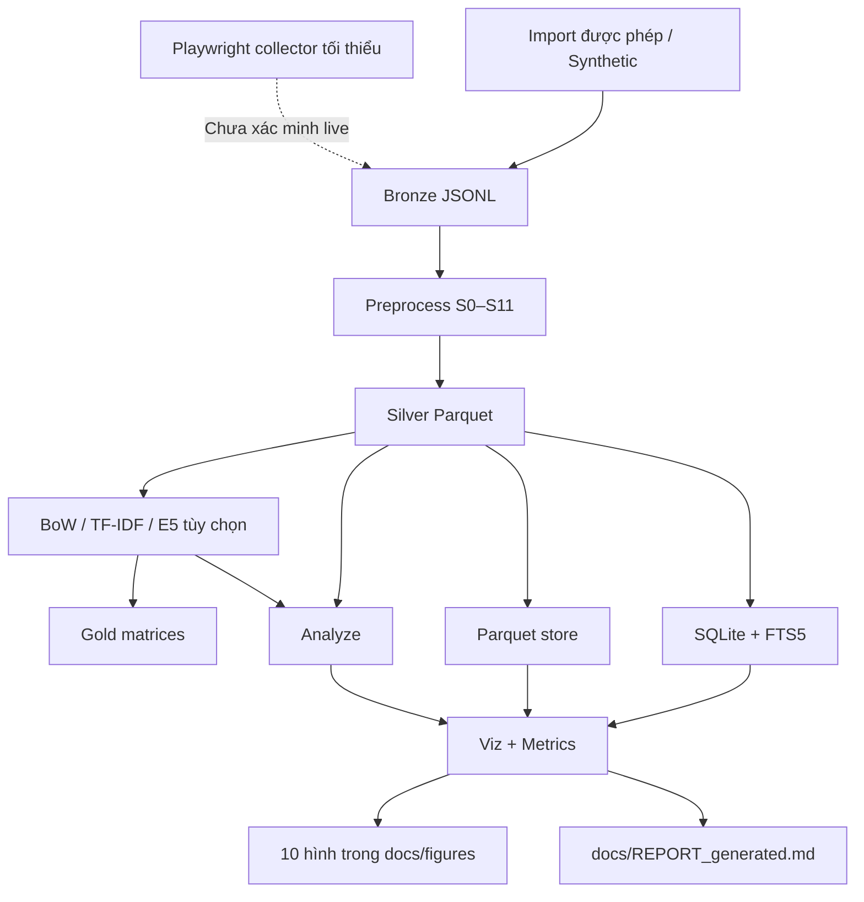
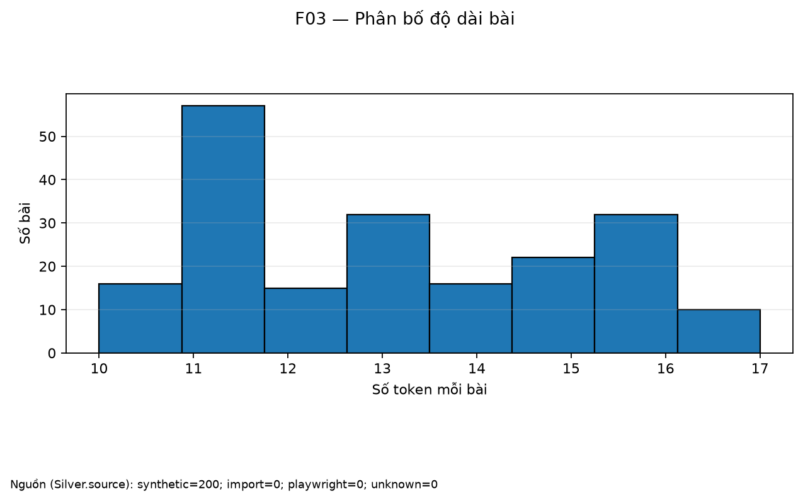

# FB Group Text Pipeline

[](https://github.com/Hoquoctrung/fb-group-text-pipeline/actions/workflows/ci.yml)

Pipeline học thuật minh họa quy trình xử lý văn bản từ Bronze đến Silver/Gold, lưu trữ và trực quan hóa.
Hỗ trợ nhập CSV/JSONL được phép sử dụng và tạo dữ liệu synthetic tái lập với seed cố định.
Lệnh `make demo` chạy end-to-end trên 200 bài synthetic, bỏ E5 và không truy cập Facebook hay tải model lúc chạy.

## Kiến trúc



**Không triển khai:** MongoDB, Elasticsearch, Big Data chuyên dụng, fastText, PhoBERT và Streamlit; các công nghệ này chỉ được mô tả lý thuyết ở phần báo cáo. Collector Playwright có mã tối thiểu nhưng crawl live chưa được xác minh với mẫu phản hồi Facebook thật.

## Hình minh họa

Các hình hiện tại minh họa dữ liệu synthetic, không phải kết quả khảo sát nhóm Facebook thật.





## Quickstart

Yêu cầu Python 3.11+. Chạy từ thư mục repo:

```bash
python3.11 -m venv .venv
source .venv/bin/activate
python -m pip install --upgrade pip && pip install -e ".[dev,nlp,embed,viz]"
cp .env.example .env
make demo
```

Lệnh demo chạy lần lượt `synth --n 200 → preprocess → represent --skip-e5 → store → analyze → viz → report`, in thời gian từng bước và dừng lỗi nếu một stage thất bại. Mục tiêu tổng thời gian là **dưới 90 giây**. Việc cài dependencies cần kết nối package registry; sau khi cài, `make demo` không cần mạng và không tải E5. Demo ghi dữ liệu tổng hợp vào `data/bronze/demo/`, đồng thời tạo lại artifacts phân tích dưới `data/`, hình ở `docs/figures/` và báo cáo tự sinh ở `docs/REPORT_generated.md`.

## 7 mục tiêu học tập (SPEC §1)

| # | Mục tiêu | Mã nguồn | Bằng chứng / báo cáo | Trạng thái trung thực |
|---:|---|---|---|---|
| 1 | Vai trò và quy trình các giai đoạn | `src/fbpipe/cli.py`, `fbpipe demo`, `data/metrics/*.json` | Sơ đồ này, `docs/REPORT_generated.md` | **Một phần** — pipeline demo chạy được; bảng stage/input/output/metric đầy đủ vẫn cần bổ sung. |
| 2 | File, scraping, crawling, API, streaming | `src/fbpipe/collect/` | `docs/REPORT.md` §2, Bảng 1 | **Một phần** — import/synthetic có thể chạy; Playwright chưa xác minh live; API và streaming chỉ mô tả lý thuyết. |
| 3 | Tiền xử lý văn bản | `src/fbpipe/preprocess/` | Metrics preprocessing, F15; `docs/REPORT.md` §3 | **Một phần** — S0–S11 được triển khai; ablation/Bảng 2/F05 chưa đủ theo SPEC đầy đủ. |
| 4 | Biểu diễn BoW, TF-IDF, embedding | `src/fbpipe/represent/` | `data/metrics/represent.json`, F13; `docs/REPORT.md` §4 | **Một phần** — BoW/TF-IDF và E5 tùy chọn; chưa có fastText/PhoBERT và nhãn tay để xác nhận chất lượng. |
| 5 | Lưu trữ SQL, NoSQL, Elasticsearch, Big Data | `src/fbpipe/storage/` | Benchmark/F14; `docs/REPORT.md` §5 | **Một phần** — SQLite+FTS5 và Parquet chạy được; MongoDB, Elasticsearch và Big Data chỉ mô tả lý thuyết; DuckDB chưa triển khai. |
| 6 | Phân tích và trực quan hóa | `src/fbpipe/analysis.py`, `src/fbpipe/viz.py` | F01/F03/F06/F07/F09/F10/F11/F13/F14/F15 | **Đã làm trong phạm vi rút gọn** — có 10 hình tĩnh; dashboard Streamlit không triển khai. |
| 7 | Thách thức, đạo đức, giới hạn thực tế | `docs/CHALLENGES.md`, `docs/ETHICS.md` | Bảng thách thức và metrics nguồn | **Một phần** — có danh mục thách thức; nhiều bằng chứng nguồn thật/PII/nhãn tay vẫn pending. |

Không có mục nào được tuyên bố hoàn tất toàn bộ SPEC hoặc có đủ số đo trên dữ liệu Facebook thật. Xem `docs/STATUS.md` và `docs/SPEC.md` để biết phạm vi chi tiết.

## Chạy với dữ liệu được phép

Chỉ nhập dữ liệu mà bạn có quyền sử dụng:

```bash
fbpipe import path/to/allowed.csv
fbpipe preprocess --force
fbpipe represent --skip-e5
fbpipe store
fbpipe analyze
fbpipe viz
fbpipe report
```

Trước khi dùng collector, đọc [`docs/ETHICS.md`](docs/ETHICS.md), kiểm tra quyền truy cập và điều khoản hiện hành. Nếu gặp CAPTCHA, login wall, checkpoint hoặc giới hạn truy cập, hãy dừng; không tìm cách vượt cơ chế kiểm soát. Parser hiện dùng fixture tự dựng, chưa chứng minh khả năng parse schema Facebook thật.

## Giới hạn đã biết

- Kết quả demo dựa trên 200 bài synthetic; không suy rộng thành hành vi người dùng hoặc nội dung nhóm thật.
- Nếu chưa có nhãn người kiểm tra, các kết quả dùng `proxy_labels=true` chỉ là chẩn đoán theo luật, không phải ground truth.
- Benchmark 1.000 dòng là các bản ghi clone/bootstrap từ Silver, không phải 1.000 bài độc lập.
- Crawl live, schema GraphQL thật, tính đại diện mẫu và tỷ lệ PII trên dữ liệu thật chưa được xác minh.
- F02/F04/F05/F08/F12/F16, tìm kiếm hybrid, DuckDB, MongoDB, Elasticsearch, Big Data, fastText, PhoBERT và dashboard Streamlit nằm ngoài phạm vi triển khai hiện tại.
- `make demo` tạo lại dữ liệu dẫn xuất, hình và báo cáo tự động. Không commit `.env`, `.auth/`, dữ liệu thật hoặc metrics chứa thông tin nhạy cảm.

## English summary

**FB Group Text Pipeline** is a coursework pipeline for authorized text import, preprocessing, feature representation, local storage, and visualization. Run `make demo` to generate 200 reproducible synthetic records and execute the offline workflow in under 90 seconds, with E5 disabled. The repository implements a reduced scope: SQLite/FTS5, Parquet, BoW/TF-IDF, and ten static figures. Live Facebook crawling is unverified; labels may be proxy labels, and the 1,000-row storage benchmark uses cloned records. MongoDB, Elasticsearch, Big Data platforms, fastText, PhoBERT, and Streamlit are theory-only or out of scope.

## Tài liệu

- [Báo cáo thủ công](docs/REPORT.md) — phần Nhận định dành cho Trung tự viết.
- [Báo cáo sinh từ metrics](docs/REPORT_generated.md)
- [Challenges](docs/CHALLENGES.md) · [Ethics](docs/ETHICS.md) · [Kiến trúc](docs/ARCHITECTURE.md) · [SPEC đầy đủ](docs/SPEC.md)
- License: MIT.
