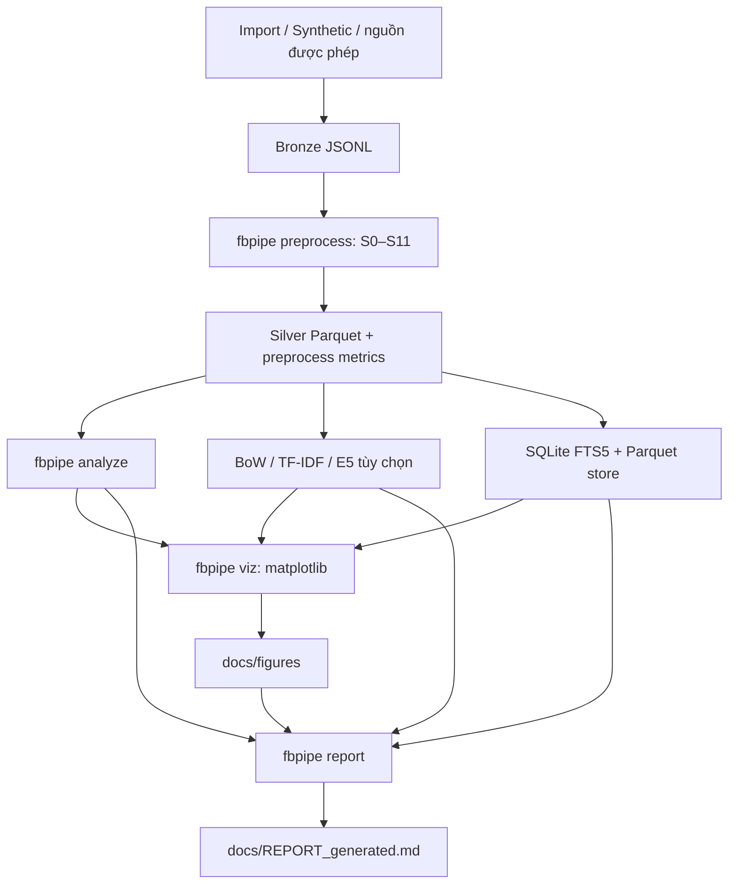

# FB Group Text Pipeline

Pipeline học thuật để thu thập **dữ liệu được phép sử dụng**, tiền xử lý văn bản, so sánh biểu diễn và lưu trữ bằng SQLite/Parquet. Các kết quả phải ghi rõ nguồn; dữ liệu synthetic và benchmark clone không được mô tả như dữ liệu Facebook thật.

## Sơ đồ pipeline



## Quickstart

Yêu cầu Python 3.11+. Tại thư mục dự án:

```bash
python3.11 -m venv .venv
source .venv/bin/activate
python -m pip install -e ".[dev,crawl,nlp,viz]"
fbpipe --help

# Dữ liệu demo tổng hợp; không cần đăng nhập Facebook
fbpipe synth --n 200
fbpipe validate data/bronze/synthetic.jsonl
fbpipe preprocess --force
fbpipe analyze
fbpipe represent --skip-e5
fbpipe label-sample --n 200
# Có thể nhập nhãn tay vào data/labels/to_label.csv trước khi đánh giá.
# Nếu chưa có nhãn tay, label-eval phải gắn cờ proxy_labels=true.
fbpipe label-eval
fbpipe store
fbpipe bench-storage --n 1000 --iterations 20
fbpipe viz
fbpipe report
```

Các đầu ra quan trọng:

- Silver và metrics tiền xử lý: `data/silver/documents.parquet`, `data/metrics/preprocess.json`.
- Metrics phân tích và biểu diễn: `data/metrics/analyze.json`, `data/metrics/represent.json`, artifact ở `data/gold/`.
- SQLite + FTS5 và Parquet store: `data/fbpipe.db`, `data/store/documents.parquet`.
- Hình matplotlib: `docs/figures/`.
- Báo cáo sinh tự động: `docs/REPORT_generated.md`.

### E5 tùy chọn

```bash
python -m pip install -e ".[embed]"
fbpipe represent --force
```

Lần đầu chạy có thể cần mạng để tải `intfloat/multilingual-e5-small`. Nếu thiếu dependency hoặc tải model lỗi, BoW/TF-IDF vẫn là đầu ra cốt lõi; E5 có thể bị bỏ qua kèm cảnh báo.

### Sinh lại hình và báo cáo

```bash
fbpipe analyze
fbpipe viz
fbpipe report
```

`fbpipe report` tổng hợp JSON có trong `data/metrics/` và các hình hiện có trong `docs/figures/`. Lệnh chỉ ghi `docs/REPORT_generated.md`, không ghi đè `docs/REPORT.md`. Phần **Nhận định** trong báo cáo tự sinh vẫn là placeholder để người nghiên cứu hoàn thiện sau khi duyệt dữ liệu và hình.

## Quy tắc an toàn và quyền riêng tư

- Chỉ thu thập dữ liệu khi có quyền/cho phép phù hợp; đọc `docs/ETHICS.md` trước khi dùng collector.
- Không vượt CAPTCHA, login wall, checkpoint hay cơ chế kiểm soát truy cập. Nếu bị chặn, dừng.
- Không commit `.env`, `.auth/`, dữ liệu thật, metrics có thể chứa thông tin nhạy cảm hoặc response chưa ẩn danh.
- Parser Facebook chưa được xác minh bằng mẫu response GraphQL thật đã ẩn danh; fixture tự tạo không chứng minh parser hoạt động với Facebook.
- `source` được theo dõi qua `synthetic`, `import`, `playwright` hoặc `unknown`. Silver cũ thiếu cột này được đọc với `source="unknown"`; chạy lại preprocessing để tái tạo Silver có provenance nếu cần.

## Trạng thái trung thực

- **Đã quan sát trong lần chạy Phase 2:** 200 bản ghi synthetic được preprocess, 0 bản ghi không hợp lệ; 53 bản ghi còn lại sau dedup và 147 bản ghi được đánh dấu trùng. Lần chạy đó ghi `ratio_code_mixed=0.94`; đây là kết quả synthetic, không phải kết quả về nhóm Facebook thật.
- **Represent/Store đã chạy trên máy phát triển:** BoW 148 chiều, TF-IDF 148 chiều, E5 báo `available`; SQLite và Parquet lưu 200 dòng; benchmark chạy trên 1.000 bản ghi clone với 20 iterations. Bản clone không đại diện 1.000 bài độc lập.
- **Kiểm thử Phase 3–4 đã báo cáo:** 61 tests passed, Ruff/pre-commit pass và Pylance Problems = 0 ở lần kiểm tra được cung cấp. Kết quả đó không xác nhận các thay đổi Phase 5–6 hiện tại.
- **Phase 5–6:** có code cho `analyze`, các hình trong phạm vi rút gọn và `report`; hãy chạy trên máy phát triển và xem file đầu ra trước khi đánh dấu hoàn tất.
- **Chưa xác minh live:** đăng nhập, probe, crawl và resume bằng phiên Facebook được phép; nguồn không có metadata phải được xem là `unknown`, không tự coi là dữ liệu thật.
- **Nhãn:** cho đến khi có nhãn tay được kiểm tra, mọi kết quả `proxy_labels=true` chỉ là chẩn đoán theo luật, không phải ground truth.
- **Ngoài phạm vi rút gọn:** PostgreSQL, MongoDB, Elasticsearch, DuckDB, Docker, Streamlit, NMF/BERTopic và capture–recapture. F09/F11 cũng chưa nằm trong lượt viz rút gọn hiện tại.

## Kiểm tra trước commit

```bash
ruff check src tests
ruff format --check src tests
pre-commit run --all-files
pytest -q

git diff --check
git status --short
```

Trước khi commit/push, xác nhận không có `.env`, `.auth/`, dữ liệu dưới `data/` hoặc response chưa duyệt trong danh sách staged.
