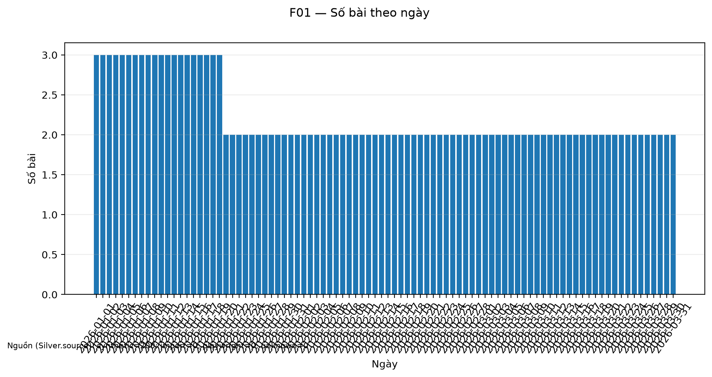
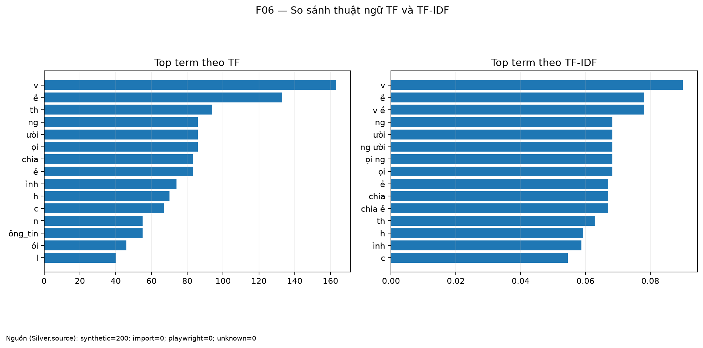
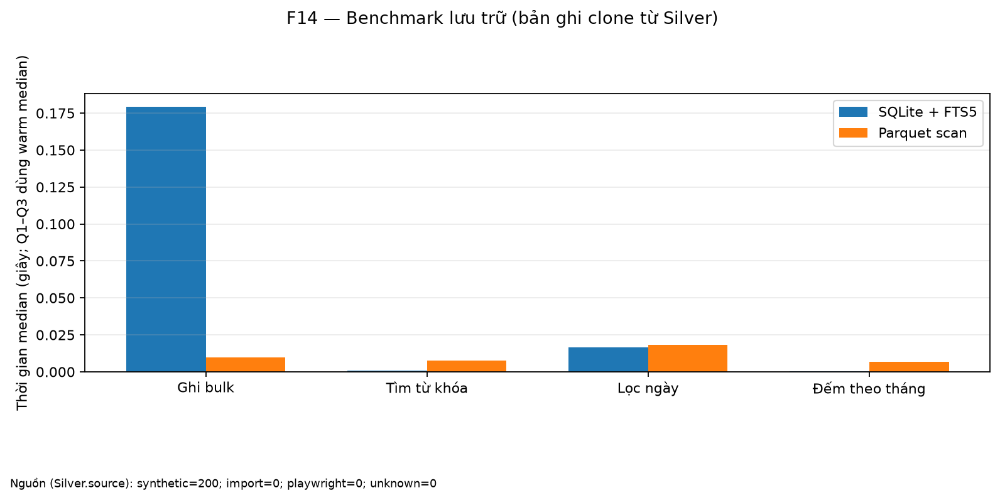
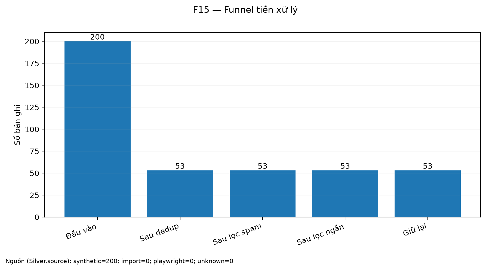

# FB Group Text Pipeline

Pipeline học thuật xử lý văn bản nhóm Facebook theo các bước thu thập được phép → tiền xử lý → biểu diễn → lưu trữ → phân tích.
Demo mặc định tạo 200 bài **synthetic**, chạy offline và bỏ qua model E5.
Kết quả synthetic, nhãn proxy và benchmark bản clone luôn được ghi rõ; crawl Facebook live chưa được xác minh.

## Kiến trúc

~~~mermaid
flowchart TD
    A["Import hợp lệ / Synthetic"] --> B["Bronze JSONL"]
    B --> C["S0–S11: preprocess"]
    C --> D["Silver Parquet + metrics"]
    D --> E["BoW / TF-IDF"]
    D -. tùy chọn .-> F["E5 (không chạy trong demo)"]
    D --> G["SQLite + FTS5"]
    D --> H["Parquet store"]
    E --> I["Analyze + F06"]
    F --> I
    G --> J["Viz + report"]
    H --> J
    I --> J
    J --> K["docs/REPORT_generated.md"]
~~~

**Ghi chú phạm vi:** MongoDB, Elasticsearch và Streamlit **không triển khai**.

## Quickstart

Yêu cầu Python 3.11+. Từ thư mục repo, chạy 5 lệnh:

~~~bash
python3.11 -m venv .venv
source .venv/bin/activate
pip install -e ".[dev,nlp,embed,viz]"
cp .env.example .env
make demo
~~~

*make demo* gọi *fbpipe demo*: tạo 200 bản ghi synthetic trong thư mục riêng *data/demo*, rồi chạy *preprocess --force* → *represent --skip-e5* → *label-eval* → *store* → *analyze* → *viz* → *report*. Demo chỉ xóa/tạo lại *data/demo* nên không xóa file import khác hay nhãn của bạn ở các thư mục khác. Metrics nằm tại *data/demo/metrics/*. Lệnh in thời gian từng bước, tổng thời gian và 15 token TF/TF-IDF của F06. Mục tiêu là hoàn thành dưới 90 giây; nếu vượt giới hạn, lệnh báo lỗi.

## Hình đầu ra mẫu

Các hình sau được sinh từ dữ liệu trong Silver; hãy chạy lại demo sau mỗi thay đổi preprocessing và duyệt hình trước khi chia sẻ.

## 7 mục tiêu → file và báo cáo (SPEC §1)

| # | Mục tiêu | File / bằng chứng | Trạng thái hiện thực |
|---:|---|---|---|
| 1 | Quy trình các giai đoạn | src/fbpipe/cli.py, data/metrics/*.json, sơ đồ kiến trúc | **Đầy đủ trong phạm vi rút gọn** |
| 2 | File import, scraping, crawling, API, streaming | src/fbpipe/collect/, docs/REPORT.md §2 | **Một phần**: import/synthetic đã triển khai; crawl chưa xác minh live; scraping/API/streaming mô tả lý thuyết |
| 3 | Làm sạch, chuẩn hóa, tokenization, stopwords, morphology | src/fbpipe/preprocess/, tests/test_preprocess.py, preprocess metrics | **Đầy đủ trong phạm vi rút gọn**; stemming/lemma chỉ cho tiếng Anh |
| 4 | BoW, TF-IDF, embedding và đánh giá | src/fbpipe/represent/, data/metrics/represent.json, F06/F13 | **Một phần**: BoW/TF-IDF triển khai; E5 tùy chọn; fastText/PhoBERT chỉ mô tả lý thuyết |
| 5 | Lưu trữ và so sánh backend | src/fbpipe/storage/, data/metrics/store.json, data/metrics/bench_storage.json, F14 | **Một phần**: SQLite/FTS5 + Parquet triển khai; MongoDB/Elasticsearch/Big Data chỉ mô tả lý thuyết |
| 6 | Phân tích và trực quan hóa | src/fbpipe/analysis.py, src/fbpipe/viz.py, F01/F03/F06/F07/F09/F10/F11/F13/F14/F15 | **Một phần**: 10 hình trong phạm vi rút gọn; không có dashboard Streamlit |
| 7 | Thách thức thực tế và đạo đức | docs/CHALLENGES.md, docs/ETHICS.md, docs/REPORT.md | **Một phần**: rủi ro và cách xử lý được mô tả; bằng chứng crawl live chưa có |

## Cảnh báo đạo đức và quyền riêng tư

- Chỉ xử lý dữ liệu có quyền sử dụng phù hợp; đọc [docs/ETHICS.md](docs/ETHICS.md) trước khi thu thập.
- Không vượt login wall, CAPTCHA, checkpoint hoặc cơ chế hạn chế truy cập. Nếu bị chặn, dừng.
- Không commit .env, .auth/, dữ liệu thật, cookie, token hoặc metrics có thông tin nhạy cảm.
- Phân biệt dữ liệu synthetic, file import và dữ liệu crawl; nhãn proxy không phải ground truth.

## Giới hạn đã biết

- **Nguồn demo:** 200 bài synthetic; crawl Facebook live và schema GraphQL chưa xác minh bằng phản hồi thật.
- **Token tiếng Việt:** regex tokenization đã được sửa để giữ Unicode; vẫn cần duyệt F06 và tỷ lệ token một ký tự trên dữ liệu được phép sử dụng.
- **Nhãn:** khi chưa có nhãn tay, label-eval dùng luật proxy và gắn proxy_labels=true.
- **Benchmark 1k:** các dòng là bản clone có nhiễu, không phải 1.000 bài độc lập.
- **Không triển khai, chỉ mô tả lý thuyết:** MongoDB, Elasticsearch, HDFS/S3 và kiến trúc Big Data, fastText tự huấn luyện, PhoBERT. Streamlit cũng không nằm trong phạm vi demo.

Xem [báo cáo thủ công](docs/REPORT.md), [báo cáo sinh tự động](docs/REPORT_generated.md), [SPEC](docs/SPEC.md) và [thách thức](docs/CHALLENGES.md). Phần **Nhận định** trong báo cáo là chỗ để Trung tự viết sau khi xem kết quả.

## English summary

An offline-first academic pipeline for authorized group-text data. The demo generates 200 synthetic posts and runs preprocessing, BoW/TF-IDF representation, proxy-label evaluation, SQLite/Parquet storage, visualization, and reporting without downloading E5. Live Facebook collection is unverified; theoretical backends and models are explicitly marked as not implemented.
