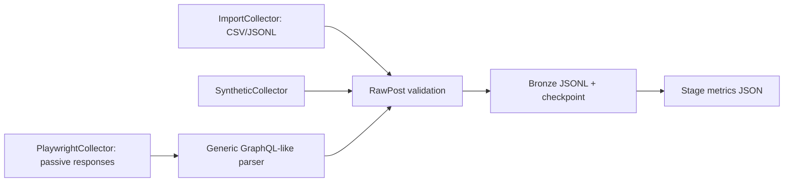

# Architecture — Phase 0 + Phase 1

## Contracts

- Each collector yields a validated `RawPost` using the common `Collector` interface.
- Browser login is performed manually; the state is stored in `.auth/` and must never be committed.
- GraphQL response bodies are observed passively. The parser intentionally uses only generic candidate keys demonstrated by a self-authored test fixture; Facebook key paths remain `TODO(real-sample)` until an anonymized probe sample is reviewed.
- Import and crawl apply basic PII scrubbing; author identifiers are HMAC-hashed when a salt is available. `crawl` requires `FBPIPE_SALT`.
- The 48-hour scope excludes DOM fallback when GraphQL works, comment collection, API demo, streaming simulation, MongoDB, Elasticsearch, Postgres, Docker, Streamlit, topic models, and capture–recapture.
- Future stages will consume Bronze output and create Silver/Gold, SQLite and Parquet/DuckDB artifacts according to `SPEC.md`; they are not implemented in this phase.
