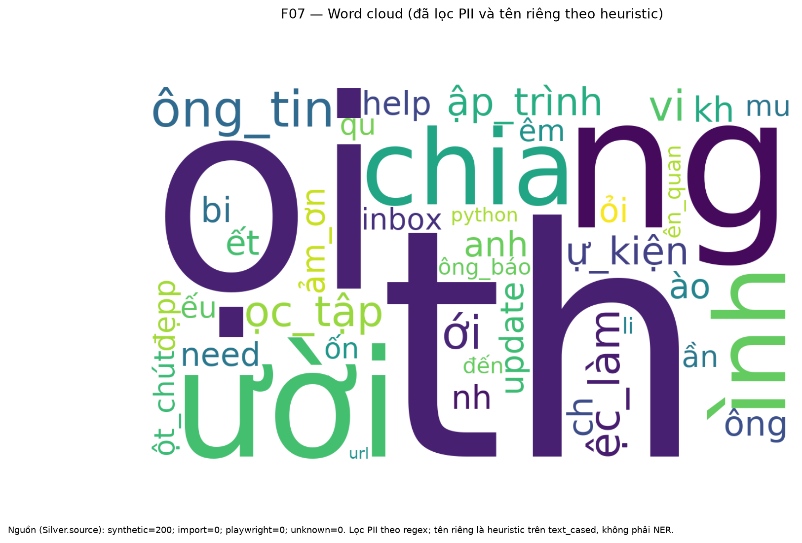
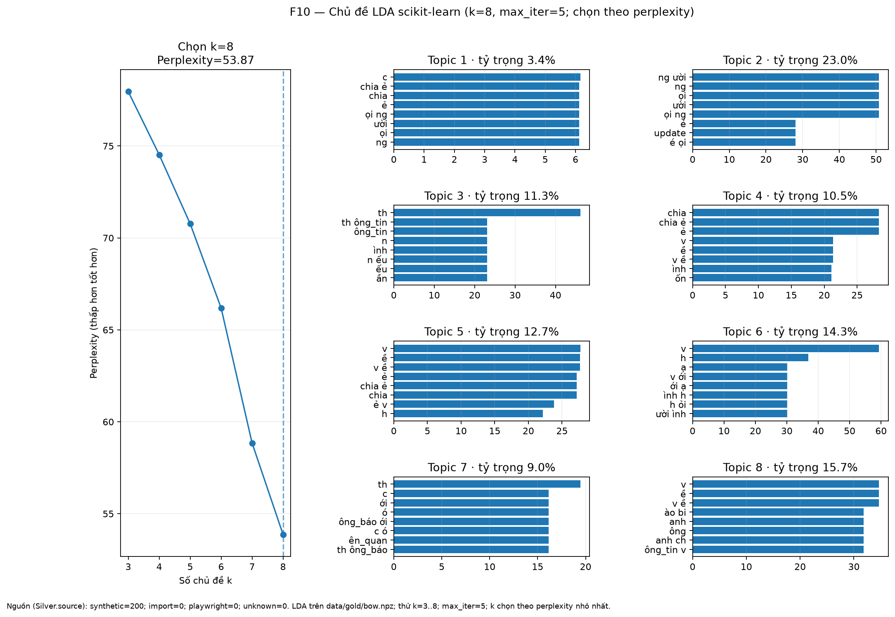
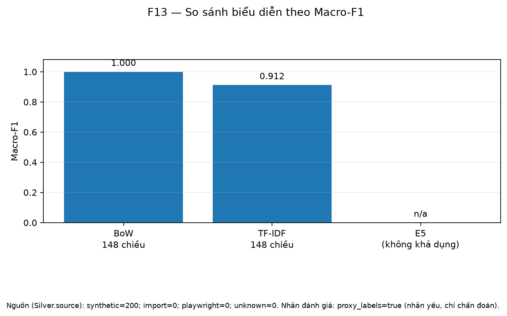

# Báo cáo tự động — FB Group Text Pipeline

> Tệp này được sinh từ `data/metrics/*.json` và danh sách hình trong `docs/figures/`. Lệnh `fbpipe report` không sửa hoặc ghi đè `docs/REPORT.md`.

- Thời điểm sinh (UTC): `2026-10-21T13:58:41+00:00`
- Thư mục metrics: `data/metrics`
- Thư mục hình: `docs/figures`
- Số tệp metrics đọc được: **9**
- Số hình/đầu ra đồ họa liệt kê được: **8**

## Nguồn dữ liệu và giới hạn diễn giải

Phân bố nguồn lấy từ trường `source_counts` của metrics (không tự suy luận nguồn nếu metrics không cung cấp):

| Nguồn | Số bản ghi |
|---|---:|
| `import` | 0 |
| `playwright` | 0 |
| `synthetic` | 200 |
| `unknown` | 0 |

Các bản ghi `synthetic` và các dòng benchmark nhân bản chỉ dùng kiểm thử/đo kỹ thuật; không được trình bày như dữ liệu Facebook thật. Metrics không thay thế việc duyệt dữ liệu nguồn hoặc kiểm tra quyền thu thập.

## Tóm tắt metrics

### `analyze.json` — analyze

| Trường | Giá trị |
|---|---|
| `stage` | `"analyze"` |
| `created_at` | `"2026-10-21T13:58:36.379881+00:00"` |
| `input_path` | `"data/silver/documents.parquet"` |
| `n_documents` | `200` |
| `source_column_present` | `true` |
| `source_counts` | `{"import": 0, "playwright": 0, "synthetic": 200, "unknown": 0}` |
| `length_distribution_tokens` | `{"max": 17, "mean": 13.095, "median": 13, "min": 10}` |
| `bow_dimensions` | `148` |
| `tfidf_dimensions` | `148` |

### `bench_storage.json` — bench_storage

| Trường | Giá trị |
|---|---|
| `n_documents` | `1000` |

> **Cảnh báo benchmark:** các dòng benchmark là bản ghi nhân bản; không tính như số bài độc lập từ nguồn.

### `import.json` — import

| Trường | Giá trị |
|---|---|
| `stage` | `"import"` |
| `created_at` | `"2026-10-21T03:03:23.635724+00:00"` |

### `label_eval.json` — label_eval

| Trường | Giá trị |
|---|---|
| `stage` | `"label_eval"` |
| `created_at` | `"2026-10-21T13:31:32.557722+00:00"` |
| `input_path` | `"data/silver/documents.parquet"` |
| `proxy_labels` | `true` |
| `n_labeled` | `200` |

> **Cảnh báo nhãn:** `proxy_labels=true`. Các điểm số này chỉ là chẩn đoán trên nhãn yếu theo luật, không phải đánh giá ground truth.

### `label_sample.json` — label_sample

| Trường | Giá trị |
|---|---|
| `stage` | `"label_sample"` |
| `created_at` | `"2026-10-21T08:44:35.908879+00:00"` |
| `input_path` | `"data/silver/documents.parquet"` |

### `preprocess.json` — preprocess

| Trường | Giá trị |
|---|---|
| `stage` | `"preprocess"` |
| `created_at` | `"2026-10-21T13:58:32.273775+00:00"` |
| `input_files` | `["data/bronze/synthetic.jsonl"]` |
| `n_documents` | `200` |
| `n_raw` | `200` |
| `n_raw_lines` | `200` |
| `n_invalid_records` | `0` |
| `n_after_dedup` | `53` |
| `n_after_spam` | `53` |
| `n_after_short` | `53` |
| `n_kept` | `53` |
| `n_duplicates` | `147` |
| `n_spam` | `0` |
| `n_short` | `0` |
| `length_distribution_tokens` | `{"max": 17, "mean": 13.095, "median": 13, "min": 10}` |
| `pipeline_seconds` | `4.815606` |
| `ablation_seconds` | `0.15946` |
| `ratio_posts_without_diacritics` | `0.0` |
| `ratio_posts_with_teencode` | `0.0` |
| `ratio_code_mixed` | `0.94` |
| `dedup_method` | `"datasketch_minhash_lsh"` |

### `represent.json` — represent

| Trường | Giá trị |
|---|---|
| `stage` | `"represent"` |
| `created_at` | `"2026-10-21T13:35:17.548409+00:00"` |
| `input_path` | `"data/silver/documents.parquet"` |
| `n_documents` | `200` |

### `store.json` — store

| Trường | Giá trị |
|---|---|
| `stage` | `"store"` |
| `created_at` | `"2026-10-21T08:57:20.166132+00:00"` |
| `input_path` | `"data/silver/documents.parquet"` |
| `sqlite_count` | `200` |
| `sqlite_size_bytes` | `516096` |
| `parquet_count` | `200` |
| `parquet_size_bytes` | `47954` |

### `synthetic.json` — synthetic

| Trường | Giá trị |
|---|---|
| `stage` | `"synthetic"` |
| `created_at` | `"2026-10-21T02:27:54.980556+00:00"` |

## Danh sách hình đã có

- [F01_daily_posts.png](figures/F01_daily_posts.png)
- [F03_length_distribution.png](figures/F03_length_distribution.png)
- [F06_top_terms_tf_tfidf.png](figures/F06_top_terms_tf_tfidf.png)
- [F07_word_cloud.png](figures/F07_word_cloud.png)
- [F10_lda_topics.png](figures/F10_lda_topics.png)
- [F13_representation_comparison.png](figures/F13_representation_comparison.png)
- [F14_storage_benchmark.png](figures/F14_storage_benchmark.png)
- [F15_preprocess_funnel.png](figures/F15_preprocess_funnel.png)

### Hình

#### F01_daily_posts

#### F03_length_distribution

#### F06_top_terms_tf_tfidf

#### F07_word_cloud

#### F10_lda_topics

#### F13_representation_comparison

#### F14_storage_benchmark

#### F15_preprocess_funnel

## Nhận định của người nghiên cứu

<!-- TRUNG VIẾT: xem dữ liệu được phép sử dụng, kiểm tra từng hình và bổ sung nhận định có bằng chứng. Không suy rộng từ dữ liệu synthetic hoặc proxy labels. -->

## Tái lập

Chạy `fbpipe analyze`, `fbpipe viz`, rồi `fbpipe report` sau khi metrics và hình đã được cập nhật. Báo cáo chỉ phản ánh các tệp tại thời điểm sinh.
