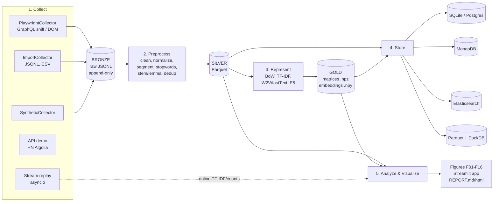

# FB-GROUP-TEXT-PIPELINE — Architect Spec v1.0

> **Đối tượng đọc:** AI coder. **Người quyết định:** Trung (sinh viên UIT).
> **Nhãn ưu tiên:** **[P0]** bắt buộc · **[P1]** cần để vượt 9/10 · **[P2]** nếu còn thời gian.
> Lưu tài liệu này vào repo tại `docs/SPEC.md`.

---

## 0. Luật làm việc cho AI coder (đọc trước, tuân thủ tuyệt đối)

1. Đọc **toàn bộ** tài liệu trước khi viết code. Làm theo thứ tự phase ở §13. Mỗi phase phải chạy được, có test, và tick đủ Definition of Done (DoD).
2. **Không bịa schema nội bộ của Facebook** (tên field GraphQL, class CSS). Parser phải được viết dựa trên mẫu phản hồi thật do lệnh `fbpipe probe` lưu ra (§5.4). Chưa có mẫu thật → viết parser phòng thủ + test bằng fixture tự dựng + để `TODO(real-sample)` rõ ràng.
3. **Cấm code né chặn:** không stealth plugin, không giả vân tay trình duyệt, không xoay proxy, không giải captcha, không tạo nhiều tài khoản. Gặp login wall / checkpoint / captcha / thông báo bị hạn chế → **dừng, lưu checkpoint, thoát với mã 3**.
4. **Không bao giờ** ghi mật khẩu, cookie, token, session, hoặc dữ liệu bài viết thật vào repo. `.gitignore` phải có trong **commit đầu tiên** (§3.3).
5. Mỗi stage **idempotent** (chạy lại không nhân đôi dữ liệu; bỏ qua nếu output mới hơn input, trừ khi `--force`) và ghi `data/metrics/<stage>.json`.
6. Code: type hints đầy đủ, docstring tiếng Anh, `ruff` sạch, `pytest` xanh. Tài liệu/báo cáo: tiếng Việt.
7. Điểm mơ hồ → chọn phương án mặc định trong tài liệu này, ghi 3–5 dòng vào `docs/DECISIONS.md` (ADR), rồi làm tiếp. Chỉ hỏi lại khi bị chặn hoàn toàn.
8. Commit nhỏ, Conventional Commits (`feat(collect): add graphql sniffer`). Không commit file > 5 MB.
9. Seed cố định (`seed=42`) ở mọi chỗ có ngẫu nhiên. Kết quả phải tái lập được.

## 0b. PHẠM VI 48 GIỜ (ghi đè §13 và mọi chỗ khác nếu mâu thuẫn)

Chỉ có 2 ngày. Chỉ làm các mục **[P0]**. BỎ HẲN [P1] và [P2], trừ các ngoại lệ ghi bên dưới.

**Làm:**
- Collect: `ImportCollector`, `SyntheticCollector`, `PlaywrightCollector` bản tối thiểu (không comment, không kênh DOM nếu kênh GraphQL đã chạy).
- Preprocess: S0–S11 gọn; stem/lemma chỉ cho token tiếng Anh; ablation chạy 4 cấu hình thay vì 8.
- Represent: BoW, TF-IDF, E5. **Bỏ fastText tự huấn luyện và PhoBERT.** So sánh bằng macro-F1 trên nhãn tay (~100 bài).
- Store: chỉ **SQLite** và **Parquet + DuckDB**, benchmark ở 1k và 10k tài liệu.
- Viz: 8–10 hình: F01, F03, F06, F07, F09, F10, F11, F13, F14, F15.
- Báo cáo: sinh bảng/hình tự động như §9.4; phần Nhận định để placeholder cho Trung.

**Ngoại lệ vẫn giữ dù là P1:** Bảng 1 (5 kỹ thuật thu thập, chỉ cần viết, không cần demo code cho API và streaming), `docs/ETHICS.md`, `docs/CHALLENGES.md` (≥ 10 hàng).

**Bỏ hẳn:** MongoDB, Elasticsearch, Postgres, Docker, Streamlit, `stream_sim`, `api_demo_hn`, NMF/BERTopic, capture–recapture, 7 notebook (chỉ cần 1 notebook demo).
Với Mongo/Elasticsearch/Big Data: chỉ **mô tả trong báo cáo** kèm bảng so sánh lý thuyết, nói rõ là không triển khai do giới hạn thời gian.
---

## 1. Mục tiêu & ma trận chấm điểm

Bài tập: thu thập (crawl) nhóm Facebook `https://www.facebook.com/groups/230048322891238`, xây pipeline xử lý văn bản từ thu thập → trực quan hóa, đẩy mã nguồn lên GitHub cá nhân. Mục tiêu: **> 9/10**.

Chiến lược điểm cao: với **mỗi** mục tiêu học tập phải có đủ bộ ba **(a) mã chạy được + (b) mục báo cáo giải thích + (c) số liệu/hình/bảng đo từ dữ liệu thật**. Người chấm thường mở README → xem cấu trúc → chạy thử → đọc báo cáo. Vì vậy README, `make demo`, và `docs/REPORT.md` quan trọng ngang code.

| # | Mục tiêu học tập | Mã nguồn chứng minh | Bằng chứng trong báo cáo | Hình / Bảng |
|---|---|---|---|---|
| 1 | Vai trò & quy trình từng giai đoạn | `cli.py` (orchestrator), `metrics/` | REPORT §1: bảng *stage → input / output / vai trò / công cụ / metric* | Sơ đồ kiến trúc, F15 (funnel) |
| 2 | Phân biệt kỹ thuật thu thập: file, scraping, crawling, API, streaming | `collect/*` (mỗi kỹ thuật một adapter/demo chạy thật) | REPORT §2 + Bảng 1 | Bảng 1 |
| 3 | Tiền xử lý: làm sạch, chuẩn hóa, stemming, lemmatization, stopwords | `preprocess/*` | REPORT §3 + **ablation** từng bước | F05, Bảng 2 |
| 4 | Chọn biểu diễn: BoW, TF-IDF, Word Embedding | `represent/*` + `evaluate.py` | REPORT §4 + so sánh định lượng | F13, F16, Bảng 3 |
| 5 | Lưu trữ: SQL, NoSQL, Elasticsearch, Big Data storage | `storage/*` + `benchmark.py` | REPORT §5 + benchmark + ma trận quyết định | F14, Bảng 4 |
| 6 | Trực quan hóa | `analyze/*`, `viz/*`, `app/streamlit_app.py` | REPORT §6 + dashboard | F01–F12 |
| 7 | Thách thức thực tế | `docs/CHALLENGES.md` + chỉ số đo thật | REPORT §7 + Bảng 5 | Bảng 5 |

**Điều kiện cần để ≥ 9:** (i) chạy end-to-end bằng 1 lệnh trên dữ liệu mẫu; (ii) có dữ liệu thật từ nhóm (≥ 300 bài, mục tiêu 1.000–3.000) hoặc giải trình trung thực nếu bị chặn (§2); (iii) mọi bảng/hình trong báo cáo sinh ra từ code, không gõ tay; (iv) phần "nhận định" (insight) do Trung tự viết; (v) có test + CI xanh + README đẹp; (vi) tuân thủ & nêu rõ đạo đức dữ liệu (§2.3).

---

## 2. Thực tế truy cập Facebook — quyết định kiến trúc số 1

### 2.1 Các đường thu thập và quyết định

| Đường | Tình trạng | Quyết định |
|---|---|---|
| Graph API cho Group | Meta tuyên bố deprecate Groups API từ Graph API v19 (23/01/2024) và gỡ khỏi mọi phiên bản trong 90 ngày | **Không khả thi.** Chỉ mô tả trong báo cáo (kỹ thuật "API") |
| Thư viện `facebook-scraper`, `mbasic.facebook.com` | Không còn bảo trì / một phần hỏng; cộng đồng báo mbasic không còn dùng được | **Không dùng.** Ghi vào báo cáo như bài học |
| **Playwright + phiên đăng nhập của chính Trung + nghe passive phản hồi GraphQL** | Khả thi nhưng giòn (schema không công bố) | **Primary** `PlaywrightCollector` |
| Playwright + parse DOM theo ARIA/role | Giòn hơn nhưng độc lập với GraphQL | **Fallback** trong cùng collector |
| Nhập file JSONL/CSV (Trung tự thu thập thủ công / dữ liệu giảng viên cấp) | Luôn chạy được | `ImportCollector` **[P0]** |
| Dữ liệu tổng hợp (synthetic) | Luôn chạy được | `SyntheticCollector` **[P0]** cho CI/demo — **luôn gắn nhãn là synthetic** |

### 2.2 Quyết định thiết kế bắt buộc

- **Adapter pattern:** mọi nguồn cài `Collector.iter_posts() -> Iterator[RawPost]`. Phần còn lại của pipeline **không biết** dữ liệu đến từ đâu. Nhờ vậy Facebook đổi giao diện hay chặn tài khoản thì pipeline vẫn chạy và bài vẫn nộp được.
- **Phiên đăng nhập do người dùng tự tạo:** lệnh `fbpipe auth` mở trình duyệt *có giao diện* để Trung tự đăng nhập (kể cả 2FA). Chương trình chỉ lưu `storage_state` vào `.auth/state.json` (gitignored). **Không bao giờ** nhập/lưu mật khẩu trong code.
- **Nghe passive:** chỉ lắng nghe `page.on("response")` các phản hồi mà trang tự tải khi cuộn. **Không** tự dựng request GraphQL, **không** tái sử dụng `doc_id`/token ngoài trình duyệt.
- **Lịch sự với máy chủ:** mỗi phiên ≤ 40 phút, ≤ 300 bài, delay ngẫu nhiên 3–8 giây giữa các lần cuộn, nhiều phiên cách nhau ≥ vài giờ. Đây là giới hạn tốc độ, không phải kỹ thuật né phát hiện.
- Thu thập tối đa **text + metadata cần thiết**; **không** tải ảnh/video, **không** thu thập hồ sơ/bạn bè/danh sách thành viên.

### 2.3 Đạo đức & pháp lý (đặt ở `docs/ETHICS.md`, đây cũng là điểm cho mục tiêu 7)

Facebook hạn chế thu thập tự động trong điều khoản và `robots.txt` — nên phải coi đây là rủi ro thật (hạn chế/khóa tài khoản). **Go/No-Go checklist** (lệnh `crawl` yêu cầu `compliance.acknowledged: true` trong config và in checklist ra màn hình):

- [ ] Đề bài/giảng viên cho phép thu thập nhóm này (nên có xác nhận bằng văn bản/tin nhắn).
- [ ] Biết nhóm **công khai hay riêng tư**. Nếu riêng tư: là thành viên **không** có nghĩa dữ liệu được phép phân phối lại → cần admin/giảng viên đồng ý; nếu không, chuyển sang `ImportCollector` với dữ liệu được cho phép.
- [ ] Dùng tài khoản của chính mình, tốc độ thấp, chấp nhận rủi ro bị hạn chế tạm thời.
- [ ] **Tối thiểu hóa & ẩn danh hóa:** băm `author_id` bằng HMAC-SHA256 với `FBPIPE_SALT` (biến môi trường), không lưu tên thật; che SĐT/email/URL trong text.
- [ ] **Không đưa dữ liệu thật lên GitHub.** Chỉ commit: mã nguồn, dữ liệu synthetic/mẫu đã ẩn danh (≤ 50 bài, đã duyệt tay), số liệu tổng hợp, hình đã kiểm tra không lộ tên người.
- [ ] Nêu căn cứ pháp lý liên quan (Nghị định 13/2023/NĐ-CP về bảo vệ dữ liệu cá nhân; Luật Bảo vệ dữ liệu cá nhân mới — **Trung kiểm tra lại văn bản hiện hành** trước khi trích) và ghi rõ mục đích: học tập, phi thương mại.

---

## 3. Kiến trúc tổng thể

### 3.1 Sơ đồ luồng (đưa nguyên vào README và `docs/ARCHITECTURE.md`)



### 3.2 Phân tầng dữ liệu (medallion)

| Tầng | Đường dẫn | Định dạng | Nội dung | Quy tắc |
|---|---|---|---|---|
| Bronze | `data/bronze/posts-<run_id>.jsonl` + `_manifest.jsonl` | JSONL | `RawPost` đúng như thu thập (đã băm author) | Append-only, bất biến |
| Silver | `data/silver/documents.parquet` | Parquet (partition theo `year_month`) | Văn bản đã làm sạch + token + cờ chất lượng | Tái tạo được từ bronze |
| Gold | `data/gold/` | `.npz` (sparse), `.npy` (dense), `.json` (vocab) | Ma trận đặc trưng, embeddings | Tái tạo được từ silver |
| Metrics | `data/metrics/<stage>.json` | JSON | Số liệu mỗi stage, nguồn cho báo cáo | Mọi con số trong REPORT lấy từ đây |

### 3.3 Cấu trúc repo

```text
fb-group-text-pipeline/
├─ README.md  LICENSE(MIT)  pyproject.toml  Makefile  docker-compose.yml
├─ .env.example  .gitignore  .pre-commit-config.yaml
├─ configs/ default.yaml  selectors.yaml  (profile_demo.yaml)
├─ resources/ vi_stopwords.txt  vi_teencode.tsv  en_extra_stopwords.txt  vi_ambiguous.txt
├─ src/fbpipe/
│  ├─ cli.py  config.py  schema.py  privacy.py  logging_utils.py  metrics.py
│  ├─ collect/   base.py  checkpoint.py  playwright_collector.py  graphql_parser.py
│  │             dom_parser.py  import_collector.py  synthetic.py  api_demo_hn.py  stream_sim.py
│  ├─ preprocess/ pipeline.py  steps.py  lang.py  segment.py  vi_resources.py  dedup.py  spam.py
│  ├─ represent/ bow.py  tfidf.py  w2v.py  transformer.py  evaluate.py  labeling.py
│  ├─ storage/   base.py  sql_repo.py  mongo_repo.py  es_repo.py  parquet_store.py  benchmark.py
│  ├─ analyze/   eda.py  ngrams.py  topics.py  clustering.py  trends.py  search.py
│  ├─ viz/       plots.py  wordcloud_vi.py  interactive.py  report.py  templates/
│  └─ app/       streamlit_app.py
├─ notebooks/    01_collect.py ... 07_challenges.py   # jupytext percent format, build ra .ipynb bằng `make notebooks`
├─ tests/        fixtures/ (graphql_sample.txt, feed_sample.html, posts_sample.jsonl)
├─ data/         (gitignored, trừ data/sample/)
├─ docs/         SPEC.md  ARCHITECTURE.md  ETHICS.md  REPORT.md  CHALLENGES.md  DECISIONS.md  figures/
└─ .github/workflows/ci.yml
```

**`.gitignore` bắt buộc (commit đầu tiên):** `data/*` (trừ `!data/sample/`), `.auth/`, `.env`, `*.parquet`, `*.npz`, `*.npy`, `*.sqlite`, `.venv/`, `__pycache__/`, `models/`, `.cache/`, `debug/`.

### 3.4 Công nghệ

Python **3.11** (tránh lỗi tương thích gensim/numpy). Tách extras trong `pyproject.toml` để CI nhẹ:

- core: `pydantic>=2`, `pydantic-settings`, `pyyaml`, `typer`, `rich`, `pandas`, `pyarrow`, `numpy`, `scikit-learn`, `tenacity`, `python-dotenv`
- `[crawl]`: `playwright`, `selectolax`
- `[nlp]`: `underthesea`, `pyvi`, `nltk`, `emoji`, `lingua-language-detector`, `datasketch`, `gensim`, `rank-bm25`
- `[embed]`: `sentence-transformers` (CPU), `umap-learn`, `hdbscan`
- `[store]`: `sqlalchemy>=2`, `duckdb`, `pymongo`, `elasticsearch>=8`
- `[viz]`: `matplotlib`, `plotly`, `wordcloud`, `networkx`, `pyldavis`, `jinja2`, `kaleido`
- `[app]`: `streamlit`
- `[dev]`: `pytest`, `pytest-cov`, `ruff`, `mypy`, `pre-commit`

Mọi phụ thuộc nặng phải **import lười** và có thông báo lỗi thân thiện ("cài `pip install .[embed]`"). Thiếu thư viện tùy chọn thì stage đó bỏ qua có cảnh báo, **không** làm hỏng cả pipeline.

---

## 4. Cấu hình, CLI, schema

### 4.1 `configs/default.yaml` (rút gọn — AI coder hoàn thiện, validate bằng pydantic)

```yaml
project: {seed: 42, data_dir: data}
group:
  id: "230048322891238"
  url: "https://www.facebook.com/groups/230048322891238"
  language_hint: auto            # vi | en | auto
compliance:
  acknowledged: false            # Trung tự đặt true sau khi đọc docs/ETHICS.md
  max_posts_per_session: 300
  max_session_minutes: 40
  delay_seconds: [3.0, 8.0]
  collect_comments: true
  max_comments_per_post: 30
privacy: {hash_authors: true, scrub_pii_in_text: true}
collect:
  adapter: playwright            # playwright | import | synthetic
  headless: false
  sort: recent                   # cố gắng chọn "bài mới" để giảm thiên lệch xếp hạng feed
  stop_after_empty_scrolls: 6
preprocess:
  segmenter: underthesea         # underthesea | pyvi | regex
  keep_cased_copy: true
  collapse_repeats_to: 2
  min_tokens: 3
  dedup: {method: minhash, threshold: 0.85, shingle: 3}
  english_morph: {stemmer: snowball, lemmatizer: wordnet}
represent:
  bow: {min_df: 3, max_df: 0.8, ngram: [1, 2]}
  tfidf: {sublinear_tf: true, ngram: [1, 2]}
  w2v: {dim: 100, window: 5, min_count: 3, epochs: 30, algo: fasttext}
  transformer: {model: intfloat/multilingual-e5-small, batch_size: 64, prefix: "query: "}
storage:
  sql_url: sqlite:///data/fbpipe.db
  mongo_url: mongodb://localhost:27017
  es_url: http://localhost:9200
```

### 4.2 CLI (Typer) — mỗi lệnh có `--help`, `--force`, `--config`

| Lệnh | Việc |
|---|---|
| `fbpipe auth` | Mở trình duyệt để Trung tự đăng nhập → lưu `.auth/state.json` |
| `fbpipe probe` | Cuộn vài lần, lưu mẫu phản hồi GraphQL **đã gỡ định danh** + HTML snapshot vào `debug/` (gitignored) để viết/sửa parser |
| `fbpipe crawl` | Chạy `PlaywrightCollector`, ghi bronze, hỗ trợ `--resume` |
| `fbpipe import FILE` / `fbpipe synth --n 1000` | Nạp file / sinh dữ liệu tổng hợp |
| `fbpipe preprocess` / `represent` / `store --backend sql\|mongo\|es\|parquet\|all` | Các stage |
| `fbpipe label-sample` / `label-eval` | Sinh CSV để gán nhãn tay / đánh giá biểu diễn (§7.4) |
| `fbpipe analyze` / `viz` / `report` / `app` | Phân tích, hình, báo cáo HTML+MD, dashboard |
| `fbpipe bench-storage` | Benchmark 4 backend (§8.3) |
| `fbpipe demo` | `synth` → toàn bộ pipeline trên dữ liệu tổng hợp ≤ 90 giây, **không cần mạng/Docker/Facebook** |
| `fbpipe run-all` | Chạy tuần tự các stage trên dữ liệu thật |

Exit code: `0` ok · `2` lỗi cấu hình · `3` bị chặn/checkpoint/login wall · `4` thiếu thư viện tùy chọn.

### 4.3 Schema (pydantic v2, `schema.py`) — hợp đồng giữa các stage

```python
class Attachment(BaseModel):
    kind: Literal["photo", "video", "link", "file", "other"]
    url_domain: str | None = None        # chỉ lưu domain, không lưu URL đầy đủ

class Comment(BaseModel):
    comment_id: str
    parent_id: str | None = None         # reply lồng nhau
    author_hash: str
    created_at: datetime | None          # UTC
    text: str
    reactions_total: int | None = None

class RawPost(BaseModel):
    schema_version: Literal["1.0"] = "1.0"
    post_id: str                         # ID ổn định nếu có; nếu không: sha1(author_hash|created_at|text[:200])
    group_id: str
    permalink_path: str | None           # chỉ path, bỏ query/tracking
    author_hash: str                     # HMAC-SHA256(salt, author_id)
    created_at: datetime | None
    collected_at: datetime
    text: str
    reactions_total: int | None = None
    reactions_by_type: dict[str, int] = {}
    comments_count: int | None = None
    shares_count: int | None = None
    attachments: list[Attachment] = []
    comments: list[Comment] = []
    source: Literal["playwright_graphql", "playwright_dom", "import", "synthetic"]
    content_hash: str                    # sha1 của text đã NFC + strip

class Collector(ABC):
    name: ClassVar[str]
    @abstractmethod
    def iter_posts(self) -> Iterator[RawPost]: ...
```

`silver/documents.parquet` — **document** = 1 dòng cho mỗi post (và, nếu bật, mỗi comment):
`doc_id, parent_id, doc_type{post,comment}, created_at, year_month, author_hash, lang, text_raw, text_clean, text_cased, tokens, tokens_nostop, stems, lemmas, n_tokens, n_emoji, n_url, n_hashtag, has_diacritics_ratio, teencode_hits, is_duplicate, dup_group, is_spam, spam_score, is_short, keep, reactions_total, comments_count`.
Phân tích mặc định lọc `doc_type=="post" & keep`.

---

## 5. STAGE 1 — COLLECT (mục tiêu 2)

### 5.1 Bảng 1 — So sánh 5 kỹ thuật (đưa vào REPORT §2; mỗi dòng có **demo chạy thật** trong repo)

| Kỹ thuật | Định nghĩa ngắn | Dùng khi | Ưu | Nhược | Hiện thực trong repo | Trạng thái với đề bài |
|---|---|---|---|---|---|---|
| **File** | Đọc dữ liệu có sẵn (CSV/JSON/dump) | Có dataset được cấp phép | Ổn định, nhanh, tái lập | Không mới, phụ thuộc người cung cấp | `ImportCollector` | Fallback chính thức |
| **Web scraping** | Trích dữ liệu từ HTML/DOM của *một trang cụ thể* | Cần vài trang, cấu trúc biết trước | Linh hoạt, không cần API | Giòn khi đổi UI, ToS | `dom_parser.py` | Dùng cho feed đã render |
| **Crawling** | Duyệt tự động *nhiều trang* theo liên kết/phân trang với hàng đợi, dedup, giới hạn tốc độ | Cần phủ rộng | Phủ lớn | Phức tạp: frontier, checkpoint, lịch sự | `PlaywrightCollector` (cuộn feed + mở permalink lấy comment) | **Primary** |
| **API** | Truy vấn endpoint chính thức, JSON có cấu trúc | Nền tảng cung cấp | Sạch, bền, có hạn mức | Bị giới hạn quyền/phạm vi; có thể bị gỡ | `api_demo_hn.py` (Hacker News Algolia API — không cần key) + giải thích vì sao Groups API không dùng được | Demo đối chiếu |
| **Streaming** | Nhận dữ liệu liên tục theo thời gian thực | Giám sát real-time | Độ trễ thấp, xử lý tăng dần | Cần hạ tầng, xử lý out-of-order | `stream_sim.py`: replay bronze theo timestamp bằng `asyncio`, đếm từ cửa sổ trượt + `HashingVectorizer`/TF-IDF tăng dần | Mô phỏng, nêu rõ là mô phỏng |

### 5.2 `ImportCollector` **[P0]** & `SyntheticCollector` **[P0]**

- Import: JSONL hoặc CSV (cột tối thiểu `text`, tùy chọn `created_at, author, reactions, comments_count`), tự băm author, tự điền `post_id`, validate qua `RawPost`, báo cáo dòng lỗi.
- Synthetic: sinh **deterministic** tiếng Việt + code-mixed Anh–Việt **giống nhiễu thật**: emoji, teencode, kéo dài ký tự ("đẹpppp"), thiếu dấu, URL/SĐT/email, hashtag, bài trùng/repost, spam quảng cáo, bài rất ngắn, phân bố thời gian có chu kỳ ngày/tuần, vài chủ đề (≥ 5) để topic model có cái để tìm. Gắn `source="synthetic"`. README ghi rõ: synthetic chỉ để test/demo, **không** dùng làm kết quả báo cáo.

### 5.3 `PlaywrightCollector` **[P0 cho cấu trúc, P1 cho độ bền]**

Luồng:
1. `auth`: `launch_persistent_context` hoặc `storage_state` lưu ở `.auth/`. Không đọc/ghi mật khẩu.
2. Mở `group.url` (cố gắng chọn sắp xếp theo bài mới; selector/URL param đặt trong `configs/selectors.yaml`, **phải kiểm chứng bằng probe**).
3. Vòng lặp cuộn: `mouse.wheel` + chờ ngẫu nhiên theo `delay_seconds`; sau mỗi lần cuộn gom dữ liệu từ **hai kênh song song**:
   - **Kênh A (ưu tiên) — GraphQL sniffer:** `page.on("response")` lọc URL chứa `/api/graphql`; thân phản hồi **có thể gồm nhiều JSON nối nhau** (parse bằng vòng lặp `json.JSONDecoder.raw_decode`); đồng thời parse các thẻ `<script type="application/json">` của HTML ban đầu. Tìm đệ quy các node giống "story" (có text nội dung, thời gian tạo, tác giả, thông tin tương tác). Dùng helper `find_nodes(obj, predicate)` + trích xuất phòng thủ (`safe_get`) thay vì đường dẫn cố định.
   - **Kênh B (fallback) — DOM:** `div[role="feed"]` → `div[role="article"]`; lấy text từ phần tử thân bài, timestamp từ `aria-label`/`<abbr>`/tooltip, link permalink từ `a[href*="/posts/"]`; click "Xem thêm / See more" trước khi lấy text. Toàn bộ selector nằm trong `selectors.yaml`.
4. Hợp nhất 2 kênh theo `post_id`/`content_hash`; ưu tiên A, bổ sung trường thiếu từ B; ghi `parse_stats` (tỷ lệ field null từng loại).
5. **Comment (tùy chọn, P1):** với top-N bài (theo `comments_count`), mở permalink, cuộn/mở rộng bình luận tới `max_comments_per_post`, parse tương tự.
6. **Checkpoint** (`checkpoint.py`): `data/bronze/checkpoint.json` = tập `seen_ids`, số lần cuộn, `last_created_at`, `run_id`. Ghi JSONL theo lô 20 bản ghi + `flush/fsync`. `--resume` bỏ qua ID đã thấy.
7. **Điều kiện dừng:** đủ `max_posts_per_session` · hết `max_session_minutes` · `stop_after_empty_scrolls` lần cuộn liên tiếp không có bài mới · phát hiện login wall/captcha/"tạm thời bị hạn chế" (kiểm bằng URL chứa `checkpoint`/`login`, hoặc selector trong `selectors.yaml`) → log `stop_reason` rồi **thoát mã 3**. Không retry vòng ngoài khi bị chặn.
8. Retry (tenacity) chỉ cho lỗi mạng tạm thời, tối đa 3 lần, backoff mũ.
9. Manifest mỗi run: `run_id, adapter, started_at, ended_at, n_posts, n_new, n_dup, n_comments, stop_reason, parse_stats, playwright_version`.

### 5.4 `fbpipe probe` — cách sống sót qua thay đổi giao diện

Lưu vào `debug/`: (a) 5–10 phản hồi GraphQL đã **gỡ định danh** (băm mọi `id`, thay tên bằng `NAME_n`), (b) `feed.html` đã gỡ nội dung cá nhân, (c) `probe_report.md` liệt kê key path nào chứa text/time/author/reaction. Parser và fixture trong `tests/fixtures/` được dựng từ đây. **Đây là cách duy nhất hợp lệ để biết schema thật.**

### 5.5 Đo chất lượng thu thập (đưa vào CHALLENGES/REPORT)

`posts/giờ`, tỷ lệ trùng, tỷ lệ parse thiếu field (author/time/reactions), số lần bị chặn, `stop_reason`. **[P2] Ước lượng độ phủ feed bằng capture–recapture (Lincoln–Petersen):** chạy 2 phiên độc lập, `N̂ ≈ n1·n2 / m` (m = số bài trùng giữa hai phiên) — chỉ báo cáo như ước lượng thô, nêu giả định.

---

## 6. STAGE 2 — PREPROCESS (mục tiêu 3)

### 6.1 Pipeline các bước (mỗi bước = một lớp `Transform` thuần, có `name`, `apply(doc)->doc`, test dạng bảng input/output)

| ID | Bước | Chi tiết bắt buộc |
|---|---|---|
| S0 | Nhận diện ngôn ngữ | `lingua-py` giới hạn {VIETNAMESE, ENGLISH} + heuristic tỷ lệ ký tự có dấu tiếng Việt (bài ngắn `lingua` kém tin cậy); ghi `lang`, `has_diacritics_ratio` |
| S1 | Chuẩn hóa Unicode | **NFC** (quan trọng với tiếng Việt: tránh "ế" dạng tổ hợp khác dạng dựng sẵn), bỏ zero-width/control char, chuẩn hóa khoảng trắng, dấu nháy cong→thẳng |
| S2 | Xóa nhiễu giao diện Facebook | "Xem thêm", "See more", "Đã chỉnh sửa", "Thích · Phản hồi", v.v. (danh sách trong `vi_resources.py`) |
| S3 | PII & thực thể kỹ thuật | URL→`<URL>`, email→`<EMAIL>`, SĐT VN (`0\d{9}`, `+84…`, có dấu chấm/cách)→`<PHONE>`, @mention→`<USER>`, hashtag: tách ra `hashtags[]` và giữ từ trong text |
| S4 | Emoji | Đếm → `n_emoji`; giữ bản `emoji.demojize` cho phân tích cảm xúc; bản `text_clean` bỏ emoji |
| S5 | Kéo dài ký tự & dấu câu | "đẹpppp"→"đẹpp" (`collapse_repeats_to=2`), "!!!!!"→"!" ; không phá từ hợp lệ có 2 ký tự lặp |
| S6 | Teencode/viết tắt | `vi_teencode.tsv` (xem §6.2), có luật ngữ cảnh |
| S7 | Lowercase | Giữ `text_cased` song song (cần cho NER/proper noun, hiển thị) |
| S8 | Tách từ | `Segmenter` interface: `underthesea.word_tokenize(format="text")` → fallback `pyvi` → fallback regex. Từ ghép nối bằng `_` ("sinh_viên"). Ghi tỷ lệ token OOV so với từ điển tham chiếu |
| S9 | Stopwords | `vi_stopwords.txt` **khớp dạng đã tách từ** (vd `bởi_vì`) + `en_extra_stopwords.txt` + NLTK English. **Domain stopwords** tự động: token có document-frequency > 0.5 đề xuất vào danh sách duyệt tay, ghi vào `resources/domain_stopwords.txt` |
| S10 | Stemming / Lemmatization | Xem §6.3 |
| S11 | Lọc chất lượng | `is_short` (< `min_tokens`), dedup (`datasketch.MinHashLSH`, shingle 3 từ, ngưỡng 0.85 → gán `dup_group`, giữ bản đại diện), `spam_score` heuristic (số SĐT, từ khóa "inbox/liên hệ/zalo/giá rẻ/sale", link, tỷ lệ chữ hoa, lặp) → **gắn cờ chứ không xóa**; `keep = not (is_duplicate or is_short or is_spam)` |

### 6.2 Teencode (hướng dẫn tạo `vi_teencode.tsv`, ≥ 120 mục, định dạng `viet_tat<TAB>dang_chuan`)

Mẫu khởi đầu: `ko→không, kg→không, hok→không, dc→được, đc→được, vs→với, j→gì, ntn→như thế nào, bt→bình thường, mn→mọi người, ae→anh em, ib→inbox, cmt→bình luận, trc→trước, rùi→rồi, bít→biết, sdt→số điện thoại, đt→điện thoại, tks→cảm ơn, nma→nhưng mà, đg→đang, ng→người, sv→sinh viên, gv→giảng viên`.
**Từ mơ hồ — KHÔNG ánh xạ mù quáng** (đặt trong `vi_ambiguous.txt`, xử lý theo ngữ cảnh): `k` (đứng sau chữ số, vd `5k` = nghìn → giữ; còn lại = "không"), `r` (= "rồi" chỉ khi đứng riêng), `mk`, `ad`, `m`, `t`. Cách mở rộng từ điển bằng dữ liệu: liệt kê token tần suất cao nhưng OOV với segmenter → Trung duyệt tay → thêm vào TSV.

### 6.3 Stemming & Lemmatization — lập trường học thuật (phải nêu trong báo cáo)

Tiếng Việt là ngôn ngữ **đơn lập** (không biến hình theo thì/số/cách) → stemming/lemmatization theo nghĩa của tiếng Anh **không áp dụng**; thứ đóng vai trò tương đương là **chuẩn hóa dấu + teencode + tách từ + chữ thường**. Vì vậy:

- Với **token tiếng Anh trong bài code-mixed** (hoặc bài thuần Anh nếu nhóm dùng tiếng Anh): token chỉ gồm ASCII chữ cái, độ dài ≥ 3, có trong `nltk.corpus.words` và không nằm trong từ điển Việt không dấu → áp **Snowball stemmer** → cột `stems`, và **WordNet lemmatizer** (POS-aware qua `nltk.pos_tag`, hoặc spaCy `en_core_web_sm` nếu cài) → cột `lemmas`.
- Với token tiếng Việt: `stems`/`lemmas` = token đã chuẩn hóa (identity) — **ghi rõ trong code & báo cáo**, không bịa thuật toán.
- Báo cáo có bảng minh họa 20 token Anh: `raw | Porter | Snowball | WordNet-lemma` và nhận xét lỗi (over/under-stemming: "university"→"univers", "better"→"better/good").
- Nếu EDA cho thấy nhóm **chủ yếu tiếng Anh**: bật đầy đủ nhánh này cho toàn bộ corpus (đổi `language_hint`).

### 6.4 Ablation tiền xử lý **[P1 — điểm cộng lớn]** (`preprocess/ablation.py`, Bảng 2 & F05)

Chạy các cấu hình tích lũy: `A0 chỉ strip` → `A1 +NFC` → `A2 +noise/PII` → `A3 +repeat/teencode` → `A4 +lowercase` → `A5 +segmentation` → `A6 +stopwords` → `A7 +english stem/lemma`. Với mỗi cấu hình ghi: **kích thước từ vựng**, % giảm so với A0, độ dài token trung bình, % OOV, **độ nhất quán chủ đề (LDA c_v)** và **macro-F1 phân loại** (§7.4) trên cùng tập. Kết luận phải *trung thực*: bước nào không cải thiện thì nói rõ (ví dụ bỏ stopwords có thể làm giảm hiệu năng của embedding Transformer — vì vậy Transformer nhận `text_clean`, **không** bỏ stopwords).

### 6.5 Chỉ số xuất ra `metrics/preprocess.json`

Funnel: `n_raw → n_after_dedup → n_after_spam → n_after_short → n_kept` (F15); tỷ lệ bài không dấu; tỷ lệ teencode; tỷ lệ code-mixed; top 30 token OOV; phân bố độ dài; thời gian từng bước.

---

## 7. STAGE 3 — REPRESENT (mục tiêu 4)

### 7.1 Các biểu diễn **[P0 cho 7.1a–b, P1 cho 7.1c–d]**

- **a. BoW** — `CountVectorizer` trên `tokens_nostop` (đã tách từ), `min_df`, `max_df`, n-gram (1,2). Lưu `.npz` + `vocab.json`. Ghi độ thưa, kích thước vocab, bộ nhớ.
- **b. TF-IDF** — `TfidfVectorizer(sublinear_tf=True)`. Bảng so sánh top term theo TF và theo TF-IDF (F06): từ chung chung mất hạng, từ đặc trưng nổi lên. Nêu công thức trong báo cáo.
- **c. Word Embedding** — (i) **fastText/Word2Vec huấn luyện trên corpus** bằng `gensim` (corpus nhỏ → chất lượng hạn chế; **nói rõ**), lấy nearest-neighbors cho 15 từ khóa & vẽ UMAP/PCA từ vựng; doc vector = trung bình có trọng số TF-IDF. (ii) **Sentence embedding tiền huấn luyện:** `intfloat/multilingual-e5-small` qua `sentence-transformers`, input `text_clean` (không bỏ stopword, không cần tách từ), thêm tiền tố `"query: "`, chuẩn hóa L2, cache `.npy`. **[P2]** biến thể PhoBERT (`vinai/phobert-base-v2`, **bắt buộc** input đã tách từ, mean-pooling).
- **d. Bảng khái niệm** BoW → TF-IDF → Static embedding → Contextual embedding: thông tin ngữ nghĩa, chiều, độ thưa, thứ tự từ, đa nghĩa, OOV, chi phí, khi nào chọn.

### 7.2 Phương pháp chọn biểu diễn (đưa vào REPORT §4)

Cây quyết định ngắn: dữ liệu ít + cần giải thích + từ khóa quan trọng → TF-IDF; cần tìm theo nghĩa/đồng nghĩa/code-mixed → sentence embedding; cần từ điển tương đồng nội miền & có corpus lớn → fastText; cần real-time nhẹ → HashingVectorizer. Đưa **bằng chứng đo được** (7.3), không chỉ lý thuyết.

### 7.3 Bảng 3 — So sánh định lượng (`represent/evaluate.py`)

Cùng tập tài liệu, cùng split, 4 biểu diễn: BoW, TF-IDF, fastText-avg, E5. Đo:

| Nhóm chỉ số | Cách đo |
|---|---|
| Hiệu quả phân loại | Logistic Regression, **stratified 5-fold × 3 lần lặp**, macro-F1 ± độ lệch chuẩn (trên nhãn tay §7.4) |
| Chất lượng cụm | KMeans/HDBSCAN: silhouette; **NMI/ARI so với nhãn tay** |
| Tìm kiếm ngữ nghĩa | 10–15 truy vấn do Trung viết; top-5 kết quả của TF-IDF / BM25 (`rank_bm25`) / E5 / **hybrid RRF** (reciprocal rank fusion); **[P2]** đánh giá nDCG@10 bằng judgments tay cho pool |
| Chi phí | Số chiều, độ thưa, bộ nhớ MB, thời gian fit/transform, độ trễ truy vấn |

Đưa kết quả vào F13 (bar có thanh sai số) và F16 (thưa/chiều/chi phí).

### 7.4 Gán nhãn tay — **việc Trung phải tự làm** (`labeling.py`)

- `fbpipe label-sample` lấy mẫu phân tầng ~**150–200 bài** (theo tháng & độ dài) → `data/labels/to_label.csv` (cột `doc_id, text_clean_preview, label`). Taxonomy ban đầu (chốt lại sau khi đọc ~50 bài đầu của nhóm thật, vì chủ đề nhóm chưa biết): `hoi_dap`, `chia_se`, `thong_bao`, `tim_kiem_tuyen_dung`, `quang_cao_spam`, `khac`.
- Gán lại ngẫu nhiên 30 bài sau ≥ 1 ngày → tính **Cohen's κ tự nhất quán** (báo cáo độ tin cậy nhãn).
- Chưa có nhãn → `label-eval` dùng **nhãn yếu theo luật** và gắn cờ `proxy_labels=true` trong mọi bảng/hình (không giả làm nhãn thật).

---

## 8. STAGE 4 — STORE (mục tiêu 5)

### 8.1 Hợp đồng chung (`storage/base.py`)

```python
class Repository(ABC):
    name: ClassVar[str]
    capabilities: ClassVar[set[str]]     # {"sql","fts","vector","aggregate","nested"}
    @abstractmethod
    def init(self, *, reset: bool = False) -> None: ...
    @abstractmethod
    def upsert_documents(self, docs: Iterable[Document]) -> int: ...
    @abstractmethod
    def count(self) -> int: ...
    @abstractmethod
    def by_date_range(self, start: datetime, end: datetime, limit: int = 100) -> list[Document]: ...
    @abstractmethod
    def keyword_search(self, query: str, limit: int = 10) -> list[Hit]: ...
    @abstractmethod
    def count_by_month(self) -> list[tuple[str, int]]: ...
    def vector_search(self, vec: np.ndarray, k: int = 10) -> list[Hit]:
        raise NotImplementedError        # backend nào không có thì ném lỗi, benchmark bỏ qua
```

Một bộ **contract test** parametrize qua mọi backend (backend cần Docker đánh dấu `@pytest.mark.integration`, tự skip khi không có dịch vụ).

### 8.2 Bốn backend

| Backend | Hiện thực | Chi tiết bắt buộc |
|---|---|---|
| **SQL** [P0] | SQLAlchemy 2 — SQLite mặc định, Postgres qua Docker (cùng model) | Bảng `authors(author_hash)`, `posts`, `comments`, `tokens_stats`; khóa ngoại, index trên `created_at`, `lang`; **FTS5** (SQLite) / `tsvector` (Postgres) cho `keyword_search`; script `schema.sql` + sơ đồ ERD (mermaid `erDiagram`) |
| **Big Data storage** [P0] | **Parquet** partition `year_month=/lang=` (pyarrow) + **DuckDB** truy vấn SQL trực tiếp trên Parquet | Minh họa columnar, predicate pushdown, nén (so kích thước JSONL vs Parquet). Mô tả (không cài) HDFS/S3 + Delta/Iceberg trong báo cáo |
| **NoSQL** [P1] | MongoDB (Docker) — document lồng (post chứa `comments[]`) | Index text + index `created_at`; `vector_search` brute-force numpy (nêu rõ) hoặc không hỗ trợ |
| **Elasticsearch** [P1] | ES 8.x single-node (Docker, tắt security chỉ cho dev) | Mapping: `text_clean` (analyzer `standard`+`lowercase`+`asciifolding` biến thể), `text_seg` (analyzer `whitespace` trên văn bản đã tách từ — ES không có analyzer tiếng Việt mặc định, **nêu rõ trong báo cáo như một thách thức**), `embedding` (`dense_vector`, cosine). Demo **tìm kiếm lai BM25 + kNN** + highlight |

`docker-compose.yml` dùng **profiles**: mặc định không khởi động gì; `--profile full` khởi động Postgres + Mongo + ES. Các phần Docker **phải tùy chọn** — pipeline lõi chạy không cần Docker.

### 8.3 Benchmark (`fbpipe bench-storage`, Bảng 4 & F14)

- Quy mô: 1k / 10k / 100k tài liệu (nhân bản có nhiễu từ silver thật bằng bootstrap, ID mới; ghi rõ là dữ liệu nhân bản).
- Truy vấn: **Q1** từ khóa đơn & cụm từ · **Q2** lọc khoảng ngày + đếm · **Q3** group-by tháng · **Q4** top-k láng giềng vector (nếu hỗ trợ) · **Q5** thông lượng ghi bulk.
- Mỗi truy vấn: 20 lần, báo **median & p95**, tách cold/warm. Ghi cấu hình máy.
- **Ma trận quyết định:** hàng = SQLite/Postgres, MongoDB, Elasticsearch, Parquet+DuckDB; cột = linh hoạt schema, full-text, vector, aggregation, scale-out, chi phí vận hành, ACID, độ phù hợp với dự án. Điền các giả thuyết lý thuyết trước, **sau đó đối chiếu với số đo** và nêu chỗ khác biệt. Kết luận có lý lẽ: vì sao dùng SQLite/Parquet làm lưu trữ chính ở quy mô này, khi nào cần ES/Mongo/Big Data thật.

---

## 9. STAGE 5 — ANALYZE & VISUALIZE (mục tiêu 6)

### 9.1 Danh mục hình (mỗi hình: PNG 200 dpi vào `docs/figures/`, bản plotly HTML tương tác nếu hợp lý; tiêu đề/nhãn trục tiếng Việt; font hỗ trợ dấu — DejaVu Sans)

| ID | Hình | Ghi chú |
|---|---|---|
| F01 | Số bài theo ngày/tuần + đường trung bình trượt | |
| F02 | Heatmap giờ × thứ trong tuần | |
| F03 | Phân bố độ dài bài (token), log-scale | |
| F04 | Tỷ lệ ngôn ngữ / có dấu / teencode / emoji | |
| F05 | Ablation: vocab size & chỉ số theo A0→A7 | từ §6.4 |
| F06 | Top term: TF vs TF-IDF (hai panel) | |
| F07 | Word cloud (font tiếng Việt, `font_path` tới DejaVu Sans, mask tuỳ chọn) | Cảnh báo: lọc tên riêng/PII trước khi xuất |
| F08 | Cụm từ hay đi cùng nhau (bigram theo **PMI**, ngưỡng tần suất tối thiểu) | |
| F09 | Chọn k cho LDA: đường coherence c_v theo k = 3…15 | |
| F10 | Chủ đề: top từ + tỷ trọng bài theo chủ đề | |
| F11 | **Bản đồ embedding** UMAP 2D, tô màu theo cụm/chủ đề, hover xem trích đoạn | plotly HTML |
| F12 | Xu hướng top-5 thuật ngữ theo tháng (+ **[P2]** phát hiện bùng nổ bằng z-score) | |
| F13 | So sánh biểu diễn: macro-F1 / NMI ± sd | từ §7.3 |
| F14 | Benchmark lưu trữ | từ §8.3 |
| F15 | Funnel làm sạch dữ liệu | từ §6.5 |
| F16 | Độ thưa / số chiều / chi phí của các biểu diễn | |

### 9.2 Phân tích

- **EDA** (`eda.py`): phân phối thời gian, độ dài, tương tác (reactions/comments, thường lệch phải → dùng log), mức tập trung đóng góp (đường cong Lorenz/Gini theo `author_hash`; **không** liệt kê danh tính người dùng).
- **Chủ đề** (`topics.py`): LDA (gensim, seed cố định, `passes` đủ hội tụ) với quét k theo c_v, chọn k bằng đỉnh coherence **và** diễn giải được; **NMF trên TF-IDF** để so sánh; **[P2]** BERTopic. Xuất `pyLDAvis` HTML.
- **Phân cụm** (`clustering.py`): KMeans/HDBSCAN trên embedding E5; đặt tên cụm bằng **c-TF-IDF** (TF-IDF cấp cụm) thay vì đoán tay.
- **Tìm kiếm** (`search.py`): TF-IDF / BM25 / E5 / hybrid RRF dùng chung một API; được dashboard gọi.
- **[P2]** Mạng đồng xuất hiện từ khóa (networkx), cảm xúc bằng mô hình tiếng Việt tiền huấn luyện (nêu rõ giới hạn miền dữ liệu).

### 9.3 Dashboard Streamlit (`app/streamlit_app.py`) **[P1]**

Tab: **Tổng quan** (KPI + funnel + F01/F02) · **Tìm kiếm** (chọn BM25/TF-IDF/E5/hybrid, so sánh song song kết quả) · **Chủ đề** (k, top-từ, pyLDAvis nhúng) · **Bản đồ embedding** · **Pipeline & Metrics** (đọc `metrics/*.json`). Dashboard chạy được trên dữ liệu `demo`. Chụp ảnh màn hình cho README.

### 9.4 Báo cáo tự động (`fbpipe report`)

Jinja2 sinh `docs/REPORT.md` + `docs/report.html` (plotly nhúng) từ `metrics/*.json` và `docs/figures/`. **Phần số liệu/hình/bảng sinh tự động; phần "Nhận định" để trống kèm placeholder `<!-- TRUNG VIẾT: … -->`** (§14) — không để AI viết thay phần insight vì sẽ thiếu trung thực nếu không đọc dữ liệu.

---

## 10. STAGE 6 — THÁCH THỨC THỰC TẾ (mục tiêu 7)

`docs/CHALLENGES.md` + REPORT §7: **Bảng 5** với cột `Thách thức | Biểu hiện trong dự án | Bằng chứng (số liệu/log) | Giải pháp đã làm | Rủi ro còn lại | Nếu làm production`. Các hàng bắt buộc (≥ 15):

1. **Truy cập:** Groups API bị gỡ; login wall; anti-bot; schema/DOM đổi liên tục → *đo:* số lần bị chặn, tỷ lệ parse lỗi, vòng đời selector.
2. **Pháp lý/đạo đức:** ToS, dữ liệu cá nhân, quyền của chủ bài viết, phân phối lại dữ liệu → *đo:* số PII bị che.
3. **Thiên lệch lấy mẫu:** feed xếp hạng theo thuật toán, cuộn vô hạn có giới hạn, bài bị xóa (survivorship), chỉ thấy bài hiển thị với tài khoản → *đo:* phân bố thời gian lệch; **[P2]** ước lượng capture–recapture.
4. **Nhiễu dữ liệu:** teencode, thiếu dấu, kéo dài ký tự, emoji, code-mixing → *đo:* các tỷ lệ ở §6.5.
5. **Trùng lặp & spam** → *đo:* funnel F15.
6. **Văn bản ngắn** → *đo:* phân bố độ dài, ảnh hưởng tới LDA (coherence thấp).
7. **Tách từ tiếng Việt & lỗi lan truyền** → *đo:* OOV, so sánh underthesea vs pyvi trên 50 câu **[P2]**.
8. **Stemming/lemma không áp dụng cho tiếng Việt** (§6.3).
9. **Châm biếm/ngữ cảnh/đa nghĩa** → ví dụ trích 5 bài (đã ẩn danh).
10. **Dữ liệu nhỏ → embedding huấn luyện tại chỗ kém** → so fastText-local vs E5.
11. **Đánh giá khi không có ground truth** → nhãn tay, κ, nhãn yếu.
12. **Analyzer tiếng Việt cho Elasticsearch/FTS** (§8.2).
13. **Mở rộng quy mô:** 1k → 100k → 100M: nút thắt ở đâu → số đo benchmark.
14. **Tái lập & triển khai:** secrets, seed, phiên bản thư viện, lịch chạy (cron/Airflow), idempotency, giám sát, lưu phiên bản dữ liệu (DVC) — *nêu trong báo cáo; không cần cài*.
15. **Concept drift/thời gian:** từ vựng/chủ đề đổi theo tháng → F12.
16. **Chi phí & độ trễ mô hình** (E5 trên CPU) → thời gian đo.

---

## 11. Kiểm thử, chất lượng, CI

- **Test bắt buộc:** schema round-trip; `privacy` (băm xác định với cùng salt, khác salt → khác băm; che SĐT/email/URL các dạng); `graphql_parser` với fixture gồm nhiều JSON nối nhau + payload nhiễu; `dom_parser` với `feed_sample.html`; `checkpoint` resume không ghi trùng; từng `Transform` (bảng input/output: NFC, `"đẹpppp quá!!!"`, `"5k"` vs `"k biết"`, URL/SĐT, emoji); dedup (hai bài gần giống → cùng `dup_group`); hình dạng/độ thưa ma trận biểu diễn; contract test cho repository; **smoke test `fbpipe demo` (200 bài synthetic, < 60 s)**.
- Độ phủ ≥ 80% cho các module không cần mạng. Parser/collector không chạm Facebook thật trong test.
- **CI** (`.github/workflows/ci.yml`): Python 3.11, cài `.[dev]` + extras nhẹ, `ruff check`, `ruff format --check`, `mypy` (lỏng), `pytest -m "not integration and not slow"`, upload coverage. Badge CI vào README.
- `pre-commit`: ruff, end-of-file, **detect-private-key**, chặn file > 5 MB, và hook tự viết chặn commit nếu `data/` (ngoài `data/sample/`) hoặc `.auth/` bị stage.

---

## 12. Sản phẩm GitHub (thứ người chấm nhìn thấy đầu tiên)

**README.md** (tiếng Việt, có mục tiếng Anh tóm tắt) theo thứ tự: tiêu đề + badge → 3 dòng mô tả → **sơ đồ kiến trúc** → ảnh dashboard + 3–4 hình đẹp nhất → **Quickstart 5 lệnh** (`pip install -e .[all]`, `playwright install chromium`, `cp .env.example .env`, `make demo`, `streamlit run`) → bảng "7 mục tiêu → file/báo cáo" (§1) → cấu trúc repo → cách chạy dữ liệu thật → **cảnh báo đạo đức/pháp lý** → giới hạn đã biết → giấy phép → tài liệu tham khảo.

Khác: `docs/REPORT.md` (+ `report.html`), `docs/ARCHITECTURE.md` (ADR, sơ đồ), `docs/ETHICS.md`, `docs/CHALLENGES.md`, `notebooks/` (7 notebook, mỗi cái chạy được trên dữ liệu demo, mỗi cái ứng với một mục tiêu), `LICENSE`, **release tag `v1.0`**, GitHub Topics, lịch sử commit sạch.

---

## 13. Lộ trình theo phase (+ DoD) và prompt giao cho AI coder

| Phase | Nội dung | Ước lượng | DoD |
|---|---|---|---|
| **0 Scaffold** | repo, `pyproject`, `.gitignore`, config, `schema`, `privacy`, logging, CLI khung, CI, `ETHICS.md`, pre-commit | 0.5 ngày | `pytest` xanh; CI xanh; `fbpipe --help` đủ lệnh |
| **1 Collect** | `Import` + `Synthetic` **trước** (mở khóa mọi thứ), rồi `auth/probe/crawl`, parser, checkpoint, `api_demo_hn`, `stream_sim` | 2 ngày | `fbpipe synth` → bronze hợp lệ; resume không trùng; 5 kỹ thuật đều có demo chạy |
| **2 Preprocess** | S0–S11, `vi_resources`, dedup, spam, ablation, metrics | 1.5 ngày | Bảng test các Transform; silver đúng schema; F05, F15 sinh ra |
| **3 Represent** | BoW, TF-IDF, fastText, E5, `labeling`, `evaluate` | 1.5 ngày | Bảng 3 + F13 + F16; cache embeddings; nhãn yếu chạy được |
| **4 Store** | 4 backend + contract test + benchmark + Docker profiles | 1.5 ngày | Contract test xanh (SQL, Parquet bắt buộc); F14 + Bảng 4 |
| **5 Analyze/Viz** | EDA, LDA/NMF, cụm, search, F01–F16, Streamlit | 2 ngày | Đủ hình; app chạy trên demo; pyLDAvis xuất |
| **6 Report/Polish** | `report`, README, notebooks, CHALLENGES, release | 1 ngày | `make demo` end-to-end sạch trên máy mới (clone → chạy) |

**Nếu hết thời gian, cắt theo thứ tự:** [P2] → ES/Mongo → Streamlit → ablation đầy đủ. **Không cắt:** import/synthetic, preprocess + ablation tối thiểu, TF-IDF vs embedding, SQL + Parquet, F01–F12, REPORT, CHALLENGES, ETHICS.

### Prompt mẫu (dán kèm `SPEC.md`; thay `N`)

> Bạn là AI coder. Đính kèm là `SPEC.md` — bản thiết kế bất biến. Hãy thực hiện **Phase N** (§13) và **chỉ** Phase N. Tuân thủ §0 tuyệt đối. Trước khi code, liệt kê file sẽ tạo/sửa. Sau khi xong: (1) chạy test và dán kết quả, (2) tick từng mục DoD của phase, (3) liệt kê quyết định chưa rõ đã ghi vào `docs/DECISIONS.md`, (4) cho tôi đúng các lệnh để chạy thử. Nếu thiếu dữ liệu thật hoặc mẫu phản hồi, đừng bịa — dùng fixture và đánh dấu `TODO(real-sample)`.

Prompt riêng cho **Phase 1b (parser sau khi có mẫu thật)**: *"Đây là `probe_report.md` và 3 mẫu phản hồi đã ẩn danh. Viết/sửa `graphql_parser.py` dựa **chỉ** trên các key path có trong mẫu; thêm fixture + test; đo tỷ lệ field null."*

---

## 14. Việc Trung phải tự làm (không giao AI được)

1. **Xác minh nhóm công khai/riêng tư và xin phép** (§2.3); điền `compliance.acknowledged: true` có ý thức.
2. Tạo `.env` với `FBPIPE_SALT` ngẫu nhiên dài (không commit, **không đổi** giữa các lần chạy).
3. Chạy `fbpipe auth` (tự đăng nhập) → `fbpipe probe` → đưa `probe_report.md` cho AI coder để chỉnh parser → chạy `crawl` nhiều phiên ngắn. Nếu bị chặn: **dừng**, ghi nhận vào CHALLENGES (đó là bằng chứng hợp lệ cho mục tiêu 7), chuyển sang dữ liệu nhập thủ công cho phép.
4. Đọc ~50 bài đầu để chốt taxonomy; **gán nhãn 150–200 bài** (~40–60 phút) + gán lại 30 bài.
5. Viết các đoạn **Nhận định** trong REPORT (xu hướng, chủ đề thật của nhóm, hạn chế). Phần này quyết định bài có "hồn" hay chỉ là pipeline máy móc.
6. Duyệt tay: danh sách stopword miền, từ điển teencode bổ sung, **mọi hình trước khi commit** (không lộ tên người/SĐT).
7. Trước `git push`: `git status` để chắc chắn không có `data/`, `.auth/`, `.env`.

---

## 15. Nghiệm thu cuối (checklist tự chấm)

- [ ] Clone mới → `make setup && make demo` chạy hết, tạo đủ hình + `report.html`.
- [ ] 7/7 mục tiêu có đủ **mã + giải thích + số đo** (đối chiếu bảng §1).
- [ ] Bảng 1–5 và F01–F16 đều sinh từ code.
- [ ] README có sơ đồ, ảnh dashboard, quickstart, cảnh báo đạo đức.
- [ ] CI xanh, coverage ≥ 80% module offline, ruff sạch.
- [ ] Không có dữ liệu thật, cookie, salt, token trong lịch sử git (`git log -p | grep` kiểm tra).
- [ ] Kết quả báo cáo ghi rõ nguồn: dữ liệu thật (N bài, thời gian thu thập, số phiên) hay nhập tay hay synthetic.
- [ ] `docs/CHALLENGES.md` ≥ 15 hàng có bằng chứng số liệu.
- [ ] Phần Nhận định do Trung viết; có mục "Hạn chế & hướng phát triển".
- [ ] Tag `v1.0`.

---

## Tài liệu tham khảo

- Meta, *Introducing Facebook Graph API v19.0 and Marketing API v19.0* (23/01/2024) — thông báo deprecate Facebook Groups API: https://developers.facebook.com/blog/post/2024/01/23/introducing-facebook-graph-and-marketing-api-v19/
- TechCrunch (05/02/2024), *Meta cuts off third-party access to Facebook Groups*: https://techcrunch.com/2024/02/05/meta-cuts-off-third-party-access-to-facebook-groups-leaving-developers-and-customers-in-disarray/
- Hacker News Search API (Algolia): https://hn.algolia.com/api
- `intfloat/multilingual-e5-small`, `vinai/phobert-base-v2` (Hugging Face); `underthesea`, `pyvi` (tách từ tiếng Việt); `datasketch` (MinHash LSH); `gensim` (LDA, fastText); `rank_bm25`; DuckDB; Elasticsearch 8 `dense_vector`.
- Nghị định 13/2023/NĐ-CP và Luật Bảo vệ dữ liệu cá nhân (kiểm tra văn bản hiện hành trước khi trích dẫn).
